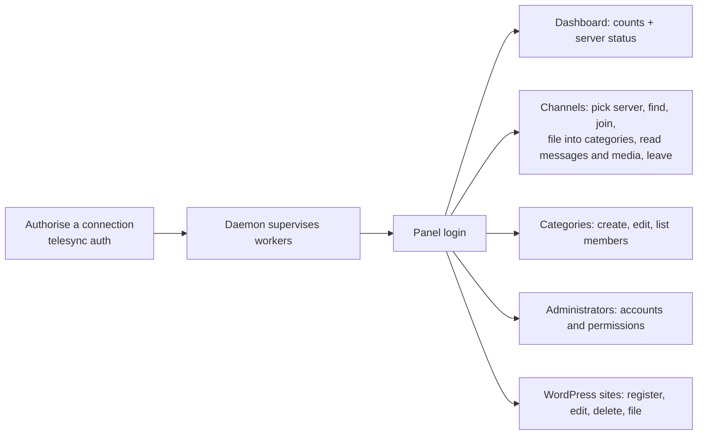
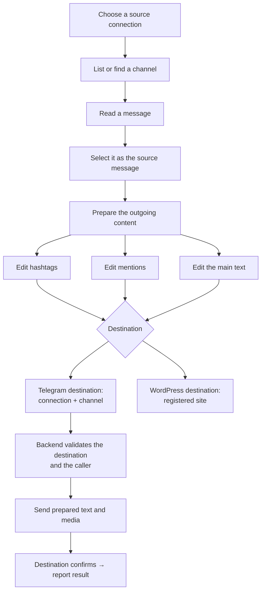

# telesync — product brief

This file is the canonical definition of **what the product is for**. It is the
first thing to read, before `AGENTS.md` and before any code.

Source of truth, in order:

1. explicit decisions of the project owner;
2. this brief (product intent);
3. the source code (what is actually implemented, today);
4. `.agents/memory/DECISIONS.md`, `ARCHITECTURE.md`, `STATE.md` (engineering);
5. older notes, comments, former reports and agent assumptions.

The source code is authoritative for **what exists**. This brief is
authoritative for **what the product is meant to do**. The absence of a feature
in the source is *not* evidence that it is out of scope.

**Do not confuse product intent with current implementation.** Throughout this
file each capability is marked:

| Mark | Meaning |
| --- | --- |
| IMPLEMENTED | In the source, exercised by tests, usable today |
| PARTIALLY IMPLEMENTED | Some of it exists; the gap is named |
| NOT IMPLEMENTED | Intended or required, no code yet |
| PRODUCT INTENT | Owner's stated direction; not scheduled, no design yet |
| UNKNOWN | Not established; needs evidence |
| REQUIRES OWNER DECISION | A product question only the owner can answer |

`STATE.md` carries the verified/unverified technical detail of each
implemented capability; this brief stays at the product level.

---

## 1. Product identity

**telesync** is a **Telegram content management and distribution system**. It
runs several Telegram accounts at once, lets operators discover and organise
the channels those accounts can see, read their content, and — as the product
evolves — take a message from one channel, prepare it as an outgoing post, and
publish it to a chosen destination: another Telegram channel or a registered
WordPress website.

The runtime that exists today covers the whole path: acquisition and
management (multiple isolated Telegram connections under supervision, a JSON
HTTP API, a local store for channels, categories and accounts, an
administrator panel, and WordPress site registration) **and** distribution —
selecting a read message, preparing an outgoing post and publishing it to a
Telegram channel or a registered WordPress site. **Publishing is implemented
but not live-verified** against real Telegram or a real WordPress site (§9).

| Step | What it means | Today |
| --- | --- | --- |
| acquire | discover channels and read messages from a source connection | IMPLEMENTED |
| manage | record channels, categories, accounts, permissions, WordPress sites | IMPLEMENTED |
| read | history, single messages, media, views, reactions | IMPLEMENTED |
| select | choose a source message to publish | IMPLEMENTED |
| prepare | edit hashtags, mentions and text into an outgoing post | IMPLEMENTED |
| publish | send to a Telegram destination channel or a WordPress site | IMPLEMENTED (not live-verified) |


## 2. The business problem

An operator who runs Telegram channels usually has to:

- follow and read **many source channels** from more than one Telegram
  account — one on Telegram production, one on a backend the operator
  controls, more later;
- give **several people** different levels of access to those channels and to
  the daemon's own management screens, without sharing credentials;
- keep an **inventory** of which channels matter, grouped into their own
  categories, independent of Telegram folders;
- turn what they read into **published posts** on channels or websites they
  control — edited, not forwarded blindly, with their own hashtags and
  mentions, and their attachments preserved.

Doing that today means several Telegram clients, a spreadsheet of channels and
access, and manual copy-paste between Telegram and a website. telesync exists
to do it in one supervised service with one API and one panel.

## 3. Who uses it

- **The operator** (deployment owner): writes the JSON configuration,
  authorises each Telegram connection once (`telesync auth`), creates
  administrators (`telesync admin`), runs the daemon.
- **Administrators** of the panel: manage other accounts and their
  permissions, register WordPress sites, manage the channel inventory.
- **Limited operators**: see and work with only the channels, categories and
  sites they have been granted.
- **Scripts and integrations**: call the bearer-token JSON API.

## 4. Domain model — glossary

These terms are used with exactly these meanings in every document and in the
code.

| Term | Meaning |
| --- | --- |
| **Telegram connection** | One configured MTProto account. Keyed by `client_key` (the `clients[].key` in the configuration). Each runs in its own worker process with its own session file, socket and endpoint. |
| **Connection type** | How a connection reaches Telegram: `official` (Telegram production, gotd defaults) or `custom` (an operator-controlled MTProto backend with explicit host, DC, keys and routing). A *technical* property only. |
| **Connection role** | What the business uses the connection for: **source** or **destination**. A *business* property. It is **not in the configuration yet** (no `role` field exists); today a role is an operator convention described in this brief. Roles and types are independent: an official connection can be a destination and a custom one a source (see §5). |
| **Source connection** | A connection whose channels are read. Discovery, channel history, single messages, media, views, reactions. |
| **Destination connection** | A connection whose channels receive published content. Its channels are the selectable Telegram publishing targets. |
| **Managed channel** | A channel the application has recorded locally after a confirmed `join`. Recorded in `managed_channels`; it is *not* every dialog the account can see. |
| **Local channel id** | `managed_channels.id`. The application's own primary key. **Every per-channel permission names this id.** |
| **Telegram channel id** | The Telegram peer id of the channel itself. Used in every `/api/v1/telegram/{key}/channels/{id}` route. The two ids are different namespaces and are never interchangeable. |
| **Client key** | The connection a record belongs to (`managed_channels.client_key`). A channel identity is always (connection, Telegram id); a local record is (client key, Telegram id) → local id. |
| **Source message** | A message read from a source channel through the worker. **Messages are not stored**; every read asks Telegram. |
| **Message media** | The attachment of a message: photo, video, document, audio, voice, sticker, gif, poll, geo, webpage, other. Described in listings; bytes fetched from a separate route (32 MiB cap). |
| **Category** | telesync's own organisational label, in its own `categories` table, shared by channels and WordPress sites. It is **not** a Telegram folder and **not** a WordPress category or tag. |
| **WordPress site** | A registered publishing destination: URL, title, icon, username and an AES-256-GCM-sealed application password. Registered and validated, and a post/attachment can be published to it (IMPLEMENTED 2026-10-31, not live-verified). |
| **Application user permission** | What an account of *this application* may do (view/update/delete a channel, a category or a site; manage users; view servers). Deny-by-default, per resource. |
| **Telegram account capability** | What a *Telegram account* can do on Telegram (read a channel, post, edit, delete). It comes from Telegram's own channel object, never from application permissions. |
| **Publishing authorization** | The policy deciding whether a user may publish to a chosen destination. The owner's required global permission `content.publish` **gates both publish routes** (D60). Whether a per-destination right is also needed is still a **product decision** (§11 #1). |
| **Publishing operation** | Selecting a source message, preparing an outgoing representation, validating the destination, publishing, and reporting what the destination actually confirmed. **IMPLEMENTED** (2026-10-31), not live-verified. |

## 5. Telegram source and destination

### 5.1 The roles

**Source.** The account whose channels are browsed. Source work is: discover
channels (`find`), list them, read history, read one message, download media,
read views and reactions. Any connection type can be a source.

**Destination.** The account whose channels receive posts. The owner's term
for it is **Cat** — the custom MTProto backend the operator controls (the
sample configuration names that client `the-cat`). Destination work is:
choosing a channel on that connection, checking that the account may post
there, sending the prepared post and its media.

A connection's names in the sample configuration (`docs/telesync.example.json`)
are `official` (type `official`) and `the-cat` (type `custom`). **These are
configuration values, not constants.** Never hardcode `telegram`, `source`,
`cat` or `the-cat` in code; read `clients[].key` (the role is not in the
configuration yet, §5.3).

### 5.2 Why the roles differ even when the adapter is shared

Both roles run the *same* gotd adapter (`internal/gotdclient`) over the same
worker/RPC/gateway path. That is deliberate: one MTProto implementation, one
session discipline, one place where Telegram errors are classified. The roles
still differ because:

- **Direction of data.** A source is read from; a destination is written to.
  The source's history routes must never cause a write. The destination's
  publish route is the only place that sends.
- **What must be validated.** Reading a channel needs membership and a read
  capability. Posting needs the channel's *post* capability — a subscriber of a
  broadcast channel can read it and still not post to it. Being able to read,
  being a member, or having a local record is **not** proof a post will be
  accepted.
- **Endpoint isolation.** A destination on the custom backend is bound to that
  backend by `internal/routing`; it can never fall back to Telegram. A source
  on Telegram production uses gotd's defaults. Mixing them would break the
  guarantee the isolation exists for.

The adapter being shared means *the mechanics* are shared. It does not make
the roles interchangeable.

### 5.3 Configuration (today)

Each entry in `clients[]` today carries `key`, `type`, `app_id`, a hash source,
a phone source, and for `custom` a `server` block. **There is no `role` field
yet.** A role is therefore a documented operator convention, not something the
daemon enforces. Adding `role` (and making a publish route refuse a
non-destination connection) is part of the publishing phase — see §11.

## 6. WordPress as a destination

A registered WordPress website is a **publishing destination of a second
kind**, not a Telegram connection. Registration (IMPLEMENTED) stores the site's
canonical https URL, its title and icon (probed live), the WordPress user, and
the application password sealed with AES-256-GCM in `wordpress_sites`; it also
links the site to telesync categories (`wordpress_site_categories`).

What the product intends for a site: prepared content becomes a post on that
site, its attachments become media in the site's library, and the post is
validated and confirmed by WordPress itself. What exists today is registration,
the probe (`wp/v2/settings`, `wp/v2/media/{id}`), the SSRF-guarded HTTP client,
and the publish path that writes posts, uploads media and confirms what
WordPress reported (`CreatePost` and friends; IMPLEMENTED 2026-10-31, not
live-verified). telesync categories are not WordPress taxonomies.

Two non-negotiable rules for any future WordPress work: the site password is
never given to a browser (`gateway.Server.Credential` is backend-only), and the
outbound request keeps the existing https-only, public-host, resolve-once,
no-redirect, no-proxy guard.

## 7. User workflows

### 7.1 What an operator and an administrator can do today



Each step is a real route/panel page; §9 marks it. The panel is the supported
way to use them; the JSON API is the integration surface.

### 7.2 The publishing workflow (IMPLEMENTED 2026-10-31, not live-verified)

The flow below is the product's workflow and is what the publish routes
implement: `POST /api/v1/telegram/{key}/messages/copy` (Telegram destination) and
`POST /api/v1/local/wordpress/{id}/posts` (WordPress destination). Live
publication against real Telegram or a real WordPress site is **not verified**.
No `/api/v1/content/publish` envelope route exists; the two destination
routes share the preparation model described here (§10.1).



Rules the implementation keeps (and any future change must keep):

- **The source message is never modified.** Preparation produces a separate
  outgoing representation.
- **The outgoing content is edited text, not a verbatim forward.** The API must
  send what the user prepared.
- **Three editable sections:** hashtags, mentions, main text. Persian, English
  and Unicode (emoji, RTL marks), line breaks and paragraph spacing are
  preserved. Hashtags and `@mentions` can be extracted from the source,
  edited, removed or added. For a Telegram destination, a source mention may be
  replaced by a reference to a destination channel — taken from trusted backend
  data, never invented. For a WordPress destination, Telegram `@mentions` are
  removed from the initial content (the user may still edit it).
- **Media is preserved where the destination supports it.** Losing media
  silently is a failure, not a fallback.
- **The destination is validated by the backend at publication time:**
  the Telegram channel is on a destination connection, the account holds the
  posting capability Telegram reports; the site is registered, reachable and
  belongs to the caller's grants.
- **Success is reported only after the destination confirms it.**
- No AI rewriting, translation, summarisation or automatic generation.
  Scheduling, bulk publishing and publication history are **not** established
  requirements (REQUIRES OWNER DECISION, §11).

## 8. Permissions — three separate concepts

### 8.1 Application user permissions (IMPLEMENTED)

What an account of this application may do. Residents of `user_permissions`,
`user_channels_permission`, `user_categories_permission`,
`user_wordpress_permission`; evaluated by `channelstore.Authorizer` and applied
through `gateway.visible()`.

Global: `users.view`, `users.manage`, `channels.view`, `channels.create`,
`categories.view`, `categories.create`, `wordpress.view`, `wordpress.create`
(manage), `servers.view`. `content.publish` is required for publishing (§10.2)
and does not exist in the source yet.

Per resource (local ids, `allow`/`deny`): view, update, delete — never create
(creation is global). Deny-by-default: an explicit deny beats the global view,
without the global view only an explicit allow admits, a write needs the view.
A kind's manage permission (`channels.create`, `categories.create`,
`wordpress.create`) also allows update and delete (D62), narrowed to the
account's **selection** — the picked items of the administrators dialog — which
is stored as a `view: allow` per picked item and an `update: deny` with a
`delete: deny` per item left out; with no per-resource row the manage right
covers every item of the kind. The operator token (`api.auth_token_env`,
loopback only) holds every permission and is not an account.

**The owner's reported bug:** an account granted one channel could see other
channels. The documented expectation is absolute — **a user granted channel A
must never see an unrelated channel B**. Enforcement path today: the local
channel list is scoped in SQL (`Store.ListChannelsForUser`); detail, messages,
avatar, leave, filing and the category's member list each call
`visible(...)`; a Telegram channel with no local record is admitted only by the
global `channels.view`. Regression tests: `internal/gateway/authz_isolation_test.go`
and `TestTheReportedScenarioThroughThePermissionAPI`. Treat the rule as an
invariant: any new route that returns or names a channel, category or site must
go through `visible()`.

### 8.2 Telegram account capabilities (IMPLEMENTED, read-only)

What the Telegram account can do *in Telegram*. `gotdclient.channelAccess`
reads creator / admin rights / banned rights / default rights, `left` and
`broadcast` from the channel object; `tgapi.NormalizePermissions` derives the
four booleans `read`, `new`, `edit`, `delete`. They are advisory, never a
guarantee for a specific message, and an unknown standing is `false` — never
optimistic. They describe the *account*, not the application user.

### 8.3 Publishing authorization (IMPLEMENTED gate; a policy gap remains)

The policy for "may this user publish to this destination". What exists and is
enforced: the global `content.publish` permission — a fixed catalogue entry
granted in the administrators dialog and reported in `/auth/me` — gates **both**
publish routes (D60), on top of the existing model (globals, per-channel and
per-site grants, deny-by-default) for source and destination visibility. What
does not exist and remains **REQUIRES OWNER DECISION**: whether an account can
be given per-destination publish rights (channel A yes, channel B no) — the
per-channel `update` grant is the closest existing concept (§11 #1). Do not add
a new permission model opportunistically.

## 9. Implementation status

| Capability | Product role | Status | Evidence / limitation |
| --- | --- | --- | --- |
| Multiple Telegram connections | Core infrastructure | IMPLEMENTED | `appconfig`, `supervisor`, `worker`; per-key session and socket |
| Connection role (source / destination) | Product model | NOT IMPLEMENTED | No `role` field; convention only |
| Source channel discovery | Content acquisition | IMPLEMENTED | `channels/find` (username, invite, id, text); text merge only unit-tested |
| Local channel management (join, list, leave, detail snapshot) | Content management | IMPLEMENTED | `managed_channels`; join/leave routes; the detail answers the stored snapshot in the canonical channel object (D58); Telegram leave verified only by unit tests |
| Channel history | Content acquisition | IMPLEMENTED | `messages.getHistory`; pagination by message id (deep pages restart) |
| Single message, replies, media, media bytes | Content acquisition | IMPLEMENTED | `channels.getMessages` + downloader, 32 MiB cap |
| Telegram message replacement | Content management | IMPLEMENTED | `PUT /api/v1/telegram/{key}/channels/{channel_id}/messages/{message_id}`; durable native edit and status polling; backend behavior **not live verified** |
| Views and reactions | Message metadata | IMPLEMENTED | from the returned `tg.Message`; never stored; custom backend support unverified |
| Telegram posting capability signal | Destination readiness | IMPLEMENTED | `permissions.new` from the channel object; `?capability=send` filters the listing, and the publish route revalidates it with Telegram |
| Users and permissions | Access control | IMPLEMENTED | Argon2id + HS256; deny-by-default; per-resource allow/deny |
| Per-channel isolation (A≠B) | Access control | IMPLEMENTED | `visible()` + SQL-scoped lists + regression tests; exercised over `httptest`, not a live listener |
| Internal categories | Organisation | IMPLEMENTED | CRUD; channel filing; category→channels listing is read-only |
| WordPress registration / metadata / authz | Destination management | IMPLEMENTED | probe, sealed credential, per-site grants; publishing writes posts/media through the sealed credential (2026-10-31) |
| Server status | Operations | IMPLEMENTED | `GET /api/v1/telegram` behind `servers.view`; dashboard card |
| Content preparation (hashtags / mentions / text, separate from the source) | Distribution | IMPLEMENTED | Editor in the panel; `content` carries text + entities; the source is never modified |
| Telegram message publishing | Distribution | IMPLEMENTED | `POST /api/v1/telegram/{key}/messages/copy`; gated by `content.publish`; live Telegram **not verified** |
| WordPress post publishing | Distribution | IMPLEMENTED | `POST /api/v1/local/wordpress/{id}/posts` with tags and media; live site **not verified** |
| Media transfer during publishing | Distribution | IMPLEMENTED | Source read → destination upload; 32 MiB cap; live transfer **not verified** |
| Publication history | Operations | IMPLEMENTED (2026-11-06, for automation) | `workflow_runs` + `workflow_publications` and `webhook_deliveries` + `webhook_attempts`; manual publishing still records only its idempotency row |
| Incoming message events | Automation | IMPLEMENTED | `automation_events` with a derived identity; deduplicated across accounts on one network; live Telegram **not verified** |
| Background job queue | Automation | IMPLEMENTED | `automation_jobs`; transactional claiming, leases, backoff, per-target ordering, restart recovery |
| Reconnection recovery | Automation | IMPLEMENTED | gotd `telegram/updates` state over SQLite plus a bounded history fallback; live gap recovery **not verified** |
| Outbound webhooks | Automation | IMPLEMENTED | CRUD, four auth modes, SSRF-restricted delivery, retries; live delivery **not verified** |
| Webhook request/response history | Automation | IMPLEMENTED | every request and response stored, redacted and truncated; UI shows the real attempt records |
| One workflow per source channel | Automation | IMPLEMENTED | `UNIQUE (managed_channels.id)` in the schema, refused in the service and the route |
| Automatic publishing to Telegram / WordPress | Automation | IMPLEMENTED | reuses the v0.0.2 publisher; per-destination results; partial failure reported as such |
| AI message polishing | Automation | IMPLEMENTED | OpenAI-compatible Chat Completions, default and custom prompts, validated structured output; **no live provider tested** |
| Optional AI image input | Automation | IMPLEMENTED | off by default, images only, bounded; independent of destination media |
| AI failure fallback | Automation | IMPLEMENTED | publishing is blocked by default; opt-in fallback publishes the original and is labelled as such |
| Automation administration UI | Operations | IMPLEMENTED | webhooks, deliveries, workflows, run history, Persian RTL, permission-based navigation; **no browser session available to verify** |
| Scheduling / bulk publishing | Automation | NOT IMPLEMENTED — REQUIRES OWNER DECISION | Out of scope for v0.0.3: no cron, no arbitrary workflow graphs |

## 10. What exists technically (summary)

The full detail is `.agents/memory/ARCHITECTURE.md`; the API contract is
`docs/api/` (generated from source).

```
HTTP / panel → daemon (gateway + supervisor + SQLite + caches)
                 │ RPC over Unix sockets (0600 in 0700)
                 ▼
             worker (one per client key) → gotd/td → Telegram or custom MTProto
```

- `cmd/telesync` entry point and CLI (`daemon`, `worker`, `auth`,
  `config validate`, `admin`, `hash-password`).
- `internal/runtime` composition; `internal/supervisor` one child process per
  client; `internal/worker` one client's service.
- `internal/gotdclient` the only gotd importer; `internal/profile`,
  `internal/routing`, `internal/keys`, `internal/sessionstore` keep a custom
  client isolated; `internal/peerstore` remembers access hashes.
- `internal/rpc` the private contract; `internal/tgapi` library-independent
  data.
- `internal/gateway` the public API (`/api/v1/...`), authentication, the one
  authorization rule; it also serves `/docs` and the panel (under `/admin`,
  with the API at `/admin/api/v1`). A binary built without the panel answers
  503.
- `internal/channelstore` SQLite (migrations 1–15): `managed_channels`,
  `categories`, `channel_categories`, `users`, `user_permissions`,
  `user_channels_permission`, `user_categories_permission`, `wordpress_sites`,
  `user_wordpress_permission`, `wordpress_site_categories`,
  `publish_operations`, and the automation tables (`automation_events`,
  `automation_event_sources`, `automation_jobs`, `automation_checkpoints`,
  `automation_update_states`, `automation_channel_pts`, `automation_peer_hashes`,
  `webhooks`, `webhook_sources`, `webhook_deliveries`, `webhook_attempts`,
  `workflows`, `workflow_destinations`, `workflow_runs`,
  `workflow_publications`, `automation_outbound_messages`). **Still no message
  table:** an event keeps a bounded snapshot of one message; it is not a
  message store.
- `internal/automation` the background subsystem: `events` (normalization,
  identity, ingestion), `queue` (the durable job runner), `recovery` (durable
  update state and the bounded backfill), `webhooks`, `workflows`, `publishing`
  (the v0.0.2 pipeline, callable from both the route and a background job),
  `ai`.
- `internal/avatarcache`, `internal/secrets`, `internal/wordpress`,
  `internal/auth`.
- `web/` the real panel (React Router 8, React 19, Vite 8, TypeScript 6,
  Tailwind 4, `@workspace/ui`, Base UI; Persian RTL), built by
  `web/scripts/build-panel.mjs` into `internal/panel/files` and embedded.
- `cmd/docsgen`, `internal/docsgen`, `internal/apidocs`, `internal/docsite`
  generate, check and embed `docs/api`.

### 10.1 The publish contract (IMPLEMENTED 2026-10-31, not live-verified)

The owner's earlier request named one envelope route,
`POST /api/v1/content/publish`, with `{source: {client_key, channel_id,
message_id}, …}`. **That route does not exist.** What is implemented is two
destination-specific routes sharing one request shape
(`internal/gateway/publish.go` `publishRequest`):

- `POST /api/v1/telegram/{key}/messages/copy` — Telegram destination. Body:
  `source: {local_channel_id, message_id}` (a local id, never a Telegram id),
  `destination: {channel_id}`, `content: {text, entities}` (UTF-16 offsets),
  `media: {mode}` (`preserve_source` | `omit`), `options: {silent,
  disable_web_page_preview}`. Idempotent per request key; reports
  `partial_failure` when the destination only partly accepted.
- `POST /api/v1/local/wordpress/{id}/posts` — WordPress destination, with tags
  and media. The site's sealed credential is opened only for the request and
  returned to nothing.

Both are gated by `content.publish` (§10.2) and checked against `visible()`;
the source message is never written to; the destination and posting capability
are revalidated at publication time. Exact field names and the complete status
list live in `docs/api/`, generated from the source — the contract, not this
section. Adding the older envelope shape on top of these routes is an open
owner decision, not a missing implementation.

### 10.2 `content.publish`

The owner requires a global permission `content.publish` to gate publishing
(requested 2026-10-30). **It exists**: `channelstore.PermissionContentPublish`,
a fixed catalogue entry granted in the administrators dialog, reported in
`/auth/me` as `permissions.content`, and enforcing both publish routes (D60).
Whether it is enough, or per-destination publish rights are needed, is §11 #1.

## 11. Open decisions (REQUIRES OWNER DECISION)

1. **Per-destination publish rights.** Is the global `content.publish` enough,
   or must an account be allowed to publish to channel A but not channel B
   (which would reuse the per-channel grant model)? Not answered.
2. **Connection role in configuration.** Add `clients[].role` (`source`,
   `destination`, both) and make publish refuse a non-destination connection?
   Assumed desirable; not decided. Until it exists, a role is a convention and
   the publish route cannot check it.
3. **Attachments in publishing.** Send each attachment as it is of the same
   kind; downgrade when the destination cannot take it; or refuse? "Never lose
   silently" is agreed; the policy for unsupported media is not.
4. **Mention replacement.** How the destination channel reference is chosen
   (an explicit choice per mention vs automatic mapping) is not decided.
5. **Publication history, scheduling, bulk publishing.** Not established
   requirements. Do not build them until the owner asks.
6. **WordPress content mapping.** How hashtags become WordPress terms (tag
   taxonomy vs categories) is not decided; telesync categories are not
   WordPress taxonomies.

## 12. Non-goals and standing constraints

These do not change with the publishing phase:

- **Reads are side-effect free.** Reading history must never mark messages read.
  Telegram mutations happen only through explicit join, leave, publish/send,
  message edit or single-message delete operations.
- **No silent fallback.** A custom connection never reaches official Telegram,
  its CDN or its bundled keys. An unknown client key is 404; an unavailable
  worker 503; never another client.
- **Clients stay isolated:** own credentials, session file, datacenter
  configuration — and now own *role*.
- **Secrets never leak:** API hashes, phones, codes, 2FA passwords, session
  bodies, access hashes, bearer tokens, key material. The WordPress site
  password never reaches a browser.
- **No invented values:** no fabricated endpoint, credential, RSA key,
  username, unread count, authorization state, publishing result or version.
- **No unnecessary frameworks or services:** no message queue, no scheduler
  service, no second Telegram library, no second frontend framework, no
  Kubernetes manifests.
- **Local state is the operator's configuration, not a Telegram mirror.**
  Messages are not stored; channels are recorded only when explicitly joined.
- **Deny-by-default permissions and the single visibility rule** stay as they
  are.
- **The panel is built from `web/`** and embedded in the binary; `panel/` is a
  stale scaffold and must not be edited.

## 13. Definition of done for a change

1. The business workflow the change belongs to is named, and it is clear
   whether the change is implementation, product intent, or design.
2. Tests exist first and fail for the right reason; the suite, `gofmt`, `vet`
   and the build are clean.
3. A route change moved together with `internal/apidocs` and `docs/api`
   (`docsgen --check` green).
4. Status of the capability is updated here (§9) if it changed.
5. Nothing above was weakened to make the change fit.
